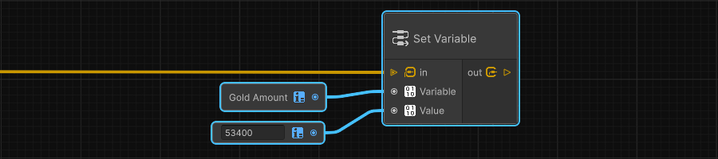

# Cozy Nodes

Cozy Nodes is a Unity package for building gameplay systems with node graphs.
Use it for dialogue, cutscenes, quests, UI flow, game-state flow, and other
game-specific systems created on top of the package.


> [!important] Unity requirement
> Cozy Nodes requires **Unity 6.6.1f1 (6000.6.1f1) or later**. Unity 6.4+
> already includes Graph Toolkit in the Editor, so do not install the old
> experimental Graph Toolkit package separately.

## 💻 Installation

1. In Unity, open **Window > Package Management > Package Manager**.
2. Select **+ > Install package from git URL...**.
3. Paste `https://github.com/ShaderFactory/Cozy-Nodes.git`.
4. Select **Install**.

Package identifier: `com.shaderfactory.cozynodes`

## 📝 How to use
### 📈 Making your first graph.
1. Create a Cozy Graph from **Assets > Create > Cozy Tools > Cozy Graph**.
2. Open the graph. It starts with `On Graph Start` connected to **Debug > Print**.
3. Change the Print message or its **Log Type** option.
4. Add **Cozy Nodes > Graph Manager** from Unity's **Add Component** menu, then assign the graph to its
   **Runtime Graph** field.
5. Enter Play Mode. The message appears in the Unity Console.

### Authoring custom nodes

Game code creates a node by inheriting from `CozyNode`. The package generates
its editor representation, so custom nodes never reference UnityEditor or Graph
Toolkit APIs directly.

### Authoring custom contexts and blocks

Contexts and blocks use the same runtime-safe, attribute-driven style as custom
nodes. A context is an ordered container shown on the graph canvas; a block is
one allowed operation inside that context. Game code never needs to reference
Graph Toolkit: Cozy Nodes generates the editor-only adapters and applies the
correct Graph Toolkit context filtering internally.

```csharp
[CozyContextMenu("Examples", "Ordered Context")]
[FlowInput]
public sealed class OrderedContext : CozyContext
{
    [Option] public string Label = "Example";
}

[CozyBlockFor(typeof(OrderedContext))]
[CozyBlockMenu("Examples", "Set Label")]
public sealed class SetLabelBlock : CozyBlock
{
    [Option] public string Label = "First step";
}
```

Contexts use `[Input]`, `[Output]`, `[Option]`, `[FlowInput]`, and
`[FlowOutput]` exactly as a `CozyNode` does. Blocks use `[Input]`, `[Output]`,
`[Option]`, and `[FlowOutput]`. A block does **not** use `[FlowInput]`: its
owning context invokes blocks in displayed order. Each block flow output is an
exit from that context into the surrounding graph. A block can be accepted by
more than one context by applying `[CozyBlockFor(...)]` more than once.
`[CozyBlockMenu("Category", "Title")]` organizes the context's **Add a Block**
menu; `[CozyBlockMenu("Title")]` is available when no category is needed.

> [!warning]
At runtime, a context calls `OnEnter`, executes its blocks in their displayed
order, then calls `OnExit`. A block normally returns `Continue()`; that moves
to the next block. A block can branch into the surrounding graph by returning
`ExitContext` with one of its own `[FlowOutput]` names:

```csharp
[CozyBlockFor(typeof(OrderedContext))]
[CozyBlockMenu("Examples", "Choose Branch")]
[FlowOutput("First")]
[FlowOutput("Second")]
public sealed class ChooseBranchBlock : CozyBlock
{
    [Option] public bool UseFirst = true;

    public override CozyBlockExecutionResult Execute(CozyBlockContext context)
    {
        return context.GetOptionValue<bool>(nameof(UseFirst))
            ? CozyBlockExecutionResult.ExitContext("First")
            : CozyBlockExecutionResult.ExitContext("Second");
    }
}
```

Wire **First** and **Second** from the block to whichever normal flow nodes
should run next. This is generic control flow: Cozy Nodes does not know or
assume that the context represents dialogue, cutscenes, or any particular game
system.

Use `[Input]` and `[Output]` for graph values. Cozy values currently support
`string`, `int`, `float`, `bool`, and one-dimensional arrays of those types.
Their serialization, defaults, and runtime copy behavior are defined in one
central value-type registry, so adding a future built-in type follows one
deliberate path rather than scattering per-type array handling through nodes.
Use `[Option]` for local node configuration that should appear in the node's
**Options** section. Options support `string`, `int`, `float`, `bool`, enums,
and `UnityEngine.Object` references. Object options use Unity's native asset
picker and preserve the chosen asset reference in the imported runtime graph;
they are useful when game code owns an authored catalog. Read graph-specific
option values at runtime with
`context.GetOptionValue<T>(nameof(Field))`.

Descriptions shown on hover: set `Tooltip` on `[Input]`, `[Output]`, `[Option]`
and `[InputList]` for their labels, and on `[CozyNodeMenu]`, `[CozyContextMenu]`
or `[CozyBlockMenu]` for the node header, for example
`[CozyNodeMenu("Utilities/String", "String Combine", Tooltip = "Joins texts.")]`.

Arrays are ordinary typed graph values. A game-authored node can declare
`[Input] public int[] Values;` and read it with
`context.GetInputValue<int[]>(nameof(Values))`. Cozy Nodes gives array values
copy semantics: a port or Blackboard read receives its own array instance.
`[InputList]` is different: it is an editor convenience for a variable number of
individual input ports, not an array travelling through a wire.

The built-in **Utilities/Array** nodes provide the first authoring path:
**Array Make** creates a typed array from configurable element inputs,
**Array Length** returns its size, and **Array Get Item** reads an index without
throwing. Get Item returns both **Item** and **Is Valid**, so a graph can handle
an out-of-range index explicitly.

Graph Toolkit has no public wildcard-value port API. Cozy Nodes therefore uses
its own explicit type-parameter metadata instead of pretending that a normal
`object` port is type-safe. Once resolved, an Int array wire can only connect
to an Int array input.

For a type parameter that represents a complete value, declare
`[CozyTypeParameter("T", AllowArrayTypes = true)]`. Its picker offers the
supported scalar types and their one-dimensional array forms. Do not enable
that setting on a parameter used as `T[]`: Cozy Nodes deliberately does not
support nested arrays.

### Type-parameter nodes

When a node must work for more than one scalar type, declare a shared type
parameter rather than using `object` as a normal port type. The graph author
chooses the parameter's concrete type in the node UI, and Cozy rebuilds every
matching port from that single persisted selection.

```csharp
[CozyNodeMenu("Utilities/Array", "Array Make")]
public class ArrayMakeNode : CozyArrayNode
{
    [Option("Element Count")]
    public int ElementCount = 2;

    [InputList(nameof(ElementCount), "Element")]
    [CozyTypeParameterPort("T")]
    public object[] Elements;

    [Output("Array")]
    [CozyTypeParameterPort("T", IsArray = true)]
    public object Result;
}
```

`object` here is only an implementation backing field. It never becomes the
graph's actual port type: `T` resolves to `string`, `int`, `float`, or `bool`,
and `T[]` resolves to the matching one-dimensional array type. A node can
explicitly opt in to using `T` itself as an array when that is meaningful, such
as **Set Variable**. A node with no selected type cannot be imported into a
runtime graph.

`[InputList]` creates a repeated input group whose count is controlled by an
integer option. Declare it on an array field, then read its values in graph order
with `context.GetInputValues<T>(nameof(Field))`.

`[ProvidedInputSet(typeof(MyProvider))]` creates an input group whose entries
come from a provider class instead of a count, for example one text input per
project language. The provider implements `ICozyInputSetProvider` and returns
`CozyProvidedInput` entries, each with a stable **key** and a display name. The
key is part of the port name (`Field::key`), so values and wires stay attached
when entries are added, removed or reordered. The provider runs in the Editor
only; read the values at runtime with
`context.GetProvidedInputValues<T>(nameof(Field))`, a dictionary keyed by entry
key. `[CozyTextArea]` on the same field applies to every string port. When the
provider's entries change, open graphs pick them up on their next graph change
or when reopened. Removing an entry removes its port and the value typed in it.
Provided input sets are supported on nodes, not on context blocks.

Flow nodes override `Execute` instead of `GetValue`. Use `[FlowInput]` and one
or more `[FlowOutput("Name")]` attributes to declare execution ports, then
return `CozyNodeExecutionResult.ContinueWith("Name")` for the path to follow.

**Control Flow > Wait For Seconds** pauses only its current graph flow for the
given number of scaled game-time seconds, then follows `out`. The pause belongs
to `CozyGraphRunner`, so it works inside a `For` Body: the next iteration begins
only after the waiting branch finishes.

### Scene Management

The built-in **Scene Management** nodes wrap the small, graph-friendly part of
Unity's `SceneManager` API:

- **Load Scene** loads a scene by Build Settings name or path, in **Single** or
  **Additive** mode. It is terminal because Unity completes even synchronous
  scene load requests on a later rendered frame, so a normal outgoing flow
  would misleadingly run before the new scene is ready.
- **Reload Active Scene** is the terminal shortcut for reloading the current
  Build Settings scene.
- **Set Active Scene** selects an already-loaded scene as Unity's destination
  for new GameObjects and source of lighting settings. It does not choose what
  the camera renders.
- **Get Active Scene Info** exposes the active scene's Name, Path, and Build
  Index as normal graph values.
- **Is Scene Loaded** checks whether an additive scene is currently loaded.

The first set deliberately does not include asynchronous loading or unloading.
Unity only exposes unloading asynchronously, and load completion needs an
explicit wait contract. Those will arrive together later rather than pretending
that a scene is immediately available after a request.

```csharp
[CozyNodeMenu("Utilities/String", "Combine String")]
public class CombineStringNode : CozyNode
{
    [Option("Input Count")]
    public int InputCount = 2;

    [InputList(nameof(InputCount), "Text", MinimumCount = 2, MaximumCount = 16)]
    public string[] Text;

    [Output]
    public string Result;

    public override object GetValue(CozyNodeContext context, string outputPortName)
    {
        if (outputPortName != nameof(Result))
            return null;

        return string.Concat(context.GetInputValues<string>(nameof(Text)));
    }
}
```

Increasing the option keeps existing input values and connections. Reducing it
removes inputs above the new count; Cozy Nodes writes a Console warning when
that would remove connected inputs.

### Sizing a text node

`[CozyNodeWidth]` gives a public custom node's input section a minimum editor
width in pixels. The output section stays compact. For a multi-line string
field, set `MinimumWidth` on `[CozyTextArea]` as well. These affect only the
Graph Toolkit presentation, not graph data or runtime behavior.

```csharp
[CozyNodeWidth(360)]
public class MultiLineTextNode : CozyNode
{
    [Input("Text")]
    [CozyTextArea(5, 8, MinimumWidth = 220)]
    public string Text;
}
```

Cozy Nodes generates and owns the required editor stylesheet beside its
generated adapter. It removes that stylesheet when the node no longer needs
one, so game projects do not accumulate stale generated styles. If a node has
several text areas, the widest requested value is used for that node's text
fields.

### Coloring important nodes

`[CozyNodeColor]` sets a public custom node's Graph Toolkit header color. The
body keeps Graph Toolkit's darker surface so ports and values stay readable.
Its red, green, and blue values normally use the 0-to-1 range.
This is editor presentation only; a graph author can still set a per-node color
in the Graph Toolkit UI when they need an exception.

For a light header, use `[CozyNodeHeaderTextColor]` to set a readable title
color without affecting the node body. `[CozyNodeAccentColor]` separately
controls Graph Toolkit's native border and accent cues.

```csharp
[CozyNodeColor(0.25f, 0.72f, 0.40f)]
[CozyNodeHeaderTextColor(0f, 0f, 0f)]
[CozyNodeAccentColor(1f, 1f, 1f)]
public class GameStartedNode : CozyNode
{
    // ...
}
```

### Adding a node icon

`[CozyNodeIcon]` places a small image beside the node title in Graph Toolkit's
header. Use a Unity asset path and a transparent monochrome image: Graph
Toolkit displays this artwork at header-icon size.

```csharp
[CozyNodeIcon("Assets/MyGame/GraphIcons/OpenDoor.png")]
public class OpenDoorNode : CozyNode
{
    // ...
}
```

### Graph entries

### Nested graphs

Cozy Nodes supports both Graph Toolkit subgraph forms.

- A **Local Subgraph** is stored inside its parent `.cozygraph` asset. Use one
  to organize a sequence that belongs only to that graph.
- An **External Subgraph** is its own `.cozygraph` asset. The parent stores a
  reference to the external graph's imported runtime asset, rather than copying
  its nodes. Edit the external graph once and every parent that uses it receives
  the new behavior when Unity reimports it.

Both forms create the same runtime call scope: inputs are copied into a fresh
child Blackboard, the primary flow returns through a flow output, and the child
scope (including its local variables and auxiliary event flows) ends when it
returns. Use an external subgraph when you deliberately want a reusable,
independently named graph asset, such as a shared splash sequence or reusable
menu flow.

External graph references cannot form a cycle. For example, `Boot → Splash →
Boot` is rejected at import time with the complete asset path chain. This keeps
runtime graph calls finite and makes asset dependencies predictable.

`On Graph Start` is the graph's default entry. It runs whenever a
`CozyGraphSession` starts, whether the session is hosted by a `CozyManager` or
created directly in game code. `On Update` runs once per Unity `Update`; `On
Late Update` runs once per Unity `LateUpdate`. They are appropriate for short
per-frame work.

A graph invocation has one **primary flow**, started by `On Graph Start`. It is
the normal sequence of that invocation and, in a subgraph, the only flow
that can return through the subgraph's output gateway. `On Event`, `On Update`,
and `On Late Update` start auxiliary flows alongside it. They share the
Blackboard for that graph invocation, but each keeps its own waits, loops, and
custom-node state.

An Update or Late Update entry is skipped only while its *own previous* flow is
still active. It does not block the primary flow or a different event entry.

`On Event` is a named entry that game code can start later:

```csharp
cozyManager.RunCustomEvent("Open Door");
```

This is different from **Wait for Event**. An On Event entry starts an auxiliary
flow; Wait for Event resumes a flow that has already reached that node. Repeating
the same On Event while its earlier invocation is still active is ignored, which
prevents accidental double-entry from repeated button presses.

**Events > Wait For Event** waits for a matching signal from game code. Its
**Event Name** is a fixed node option, so the graph clearly shows what it is
waiting for:

```csharp
cozyManager.Trigger("Advance Dialogue");
```

Every active matching wait can accept the signal. A different name, or a signal
sent while no flow is waiting at that node, is ignored.

For a signal that should be visible to every live graph session, add a
**Cozy Graph Global Event Emitter** component to any GameObject and invoke its
`Emit(string)` method from a UnityEvent or Animation Event. It broadcasts to all
live sessions. In each session it resumes matching **Wait For Event** flows and
starts matching **On Event** entries. Game code can use the same bus directly:

```csharp
CozyGraphGlobalEvents.Emit("MyGame.Splash.ContinueRequested");
```

Use namespaced event names for global signals. `CozyManager.Trigger` remains the
targeted alternative when code knows the one graph session it needs to resume.

`Emit Event` travels in the opposite direction: it publishes an outgoing graph
notification. Add a **Cozy Graph Event Listener** component to a scene object,
enter the emitted event name, and connect **On Event Received** to any UnityEvent
target. For example, a graph can emit `MyGame.Splash.SkipApproved` and the
listener can call an Animator's `SetTrigger("SkipSplash")`. The graph owns the
decision; the scene owns the visual response.

### Running without a GameObject

`CozyManager` is the convenient Unity host: it creates a session, starts it in
its own `Start`, and advances it from `Update` and `LateUpdate`. Game code can
also own a graph execution directly, with no GameObject:

```csharp
CozyGraphSession dialogue = new CozyGraphSession(dialogueGraph);
dialogue.RunGraph();
dialogue.Update(Time.deltaTime);
dialogue.Trigger("Advance Dialogue");
```

Each session owns its own variables, temporary node state, waits, and subgraph
frames. The imported graph remains shared, immutable data, so multiple sessions
can safely run the same graph independently.

### Runtime API boundary

Game code and custom nodes should work through `CozyGraphSession`,
`CozyManager`, `CozyNodeContext`, and the public node/context/block contracts.
The imported node records, ports, runner, execution frames, and reflection
metadata are Cozy Nodes implementation details; they are intentionally not a
gameplay API.

When a custom node receives a Blackboard variable through an input, use
`context.TryGetInputVariableID(...)` and pass that stable ID to
`context.Session.TryGetBlackboardValue(...)` or
`context.Session.TrySetBlackboardValue(...)`. This changes only the current
session and never mutates the `.cozygraph` asset.

## Nodes

<details>
<summary>Set Variable Node</summary>

Changes a Blackboard variable for this running graph only. Connect the Blackboard variable node to **Variable** and its new value to **Value**.


</details>

<details>
<summary>Integer Math Node</summary>

Performs the selected operation—**Add**, **Subtract**, **Multiply**, or
**Divide**—on integer inputs **A** and **B**. Division by zero returns `0`.

</details>

<details>
<summary>Compare Numbers Node</summary>

Compares numeric inputs **A** and **B** using **Greater Than**, **Greater Than
or Equal**, **Less Than**, **Less Than or Equal**, **Equal**, or **Not Equal**.
Its Float inputs also accept Integer wires through Cozy's implicit conversion.

</details>

<details>
<summary>Compare Boolean Node</summary>

Compares boolean inputs **A** and **B** using **Equal** or **Not Equal**. Its
boolean **Result** can connect directly to an If/Else node.

</details>

<details>
<summary>Compare Strings Node</summary>

Compares text inputs **A** and **B** using case-sensitive, exact **Equal** or
**Not Equal** matching. Use the dedicated String Contains, String Starts With,
or String Ends With nodes for those kinds of text tests.

</details>

<details>
<summary>Float Math Node</summary>

Performs the selected operation—**Add**, **Subtract**, **Multiply**, or
**Divide**—on float inputs **A** and **B**. Choose the operation in the node's
**Options** section; the node returns the calculated **Result**.

</details>

<details>
<summary>If/Else Node</summary>

Routes execution through **True** when **Condition** is true; otherwise, it
routes execution through **False**. This is a public `CozyNode` flow node, so
game code defines it without a paired Editor node.

</details>

<details>
<summary>Print Node</summary>

Writes **Message** to the Unity Console. Choose **Log**, **Warning**, **Error**,
**Assert**, or **Exception** from its **Log Type** option.

</details>

<details>
<summary>For Node</summary>

Runs **Body** once for every integer from **Start** (inclusive) to **End**
(exclusive), moving by **Step**. **Index** provides the current iteration value;
**Exit** runs after the loop ends. Connect a Body path to **Break** to leave the
active loop immediately through Exit. A negative Step counts down, while a Step
of zero reports a graph error.

</details>

## Development status

> [!warning]
> Cozy Nodes is under active development. Execution, triggers, events,
> Blackboard reads and runtime variable writes, the public API for custom game
> nodes, public flow nodes, loops, basic integer math, and basic floating-point utilities are available.
> Save-data nodes and additional floating-point utilities are planned next.
